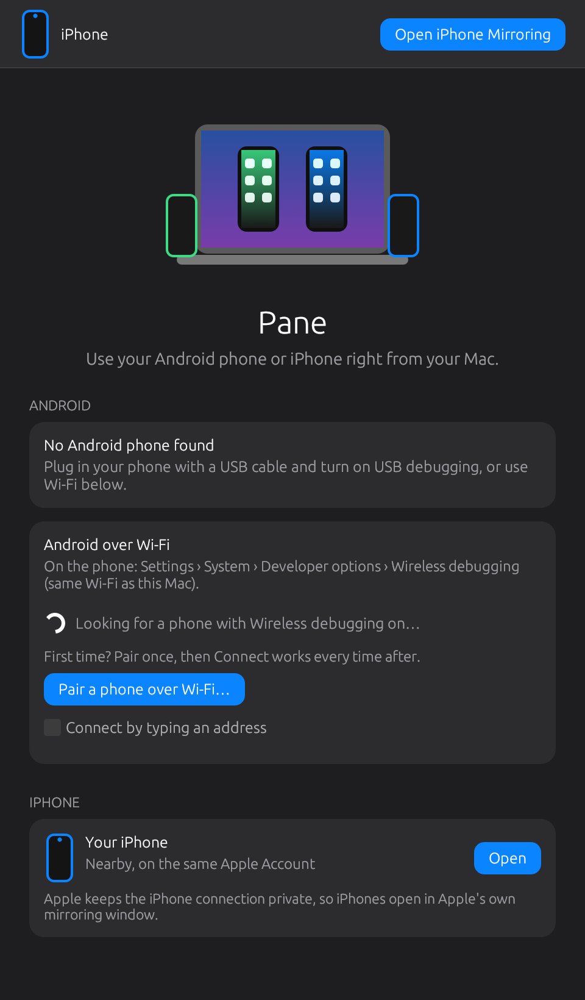
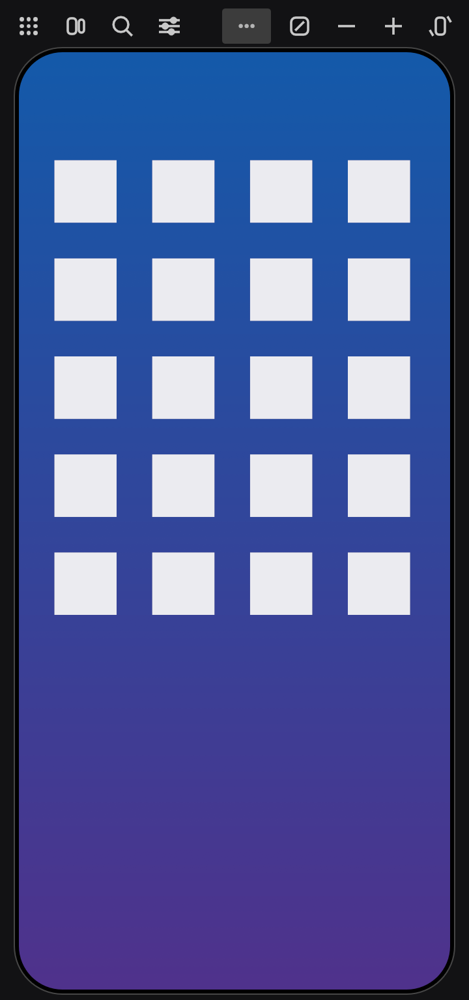

# Pane

**Use your Android phone or iPhone from your Mac.**

Pane puts your phone in a window on your desktop. On Android the screen shows live: click to tap,
drag to swipe, type on your Mac keyboard to send text. On iPhone, one click opens Apple's own
iPhone Mirroring.

<p align="center">
  
  &nbsp;&nbsp;
  
</p>
<p align="center"><sub>Left: the start screen. Right: a phone window (the built-in demo phone, so no real phone is shown).</sub></p>

## What it does

### Android
- **Live screen** in a window you can resize, zoom, and rotate.
- **Click to tap, drag to swipe, Esc or right-click for Back, type to send text.**
- **Toolbar:** Home, App Switcher, Search, Quick Settings, zoom in and out, rotate.
- **USB cable or Wi-Fi.** Pair over Wi-Fi once (scan a QR code from the phone, or type a six-digit code),
  and Connect works every time after that.
- **Smooth video.** With `ffmpeg` installed, Pane streams the phone's screen live: about 35 to 45
  pictures a second on average and up to 80 while the screen is moving (measured on a Pixel 6 over Wi-Fi).
  Without `ffmpeg` it still works, using a screenshot per frame (2 to 9 pictures a second).
- **Keeps going.** If the phone screen turns off, Pane retries every 10 seconds and picks the stream
  back up when it wakes. Helper programs are shut down cleanly when you close the window.

### iPhone
Apple keeps the iPhone connection private, so Pane cannot draw an iPhone itself. Instead it gives
you a **pinned "Open iPhone Mirroring" button** at the top of the window (also in the phone window's
••• menu) that opens Apple's own app with one click.

## What you need

- A Mac with [Rust](https://rustup.rs) installed.
- Android's tools: `brew install android-platform-tools`
- For smooth live video: `brew install ffmpeg`
- On the Android phone: **Developer options** turned on, then **USB debugging** (cable)
  or **Wireless debugging** (Wi-Fi).
- For iPhone: a Mac and iPhone that already work with Apple's iPhone Mirroring.

## Build and run

```sh
git clone https://github.com/anthonyonazure/pane.git
cd pane
cargo build --release
./target/release/pane
```

No phone handy? Try the built-in pretend phone: `./target/release/pane --demo`

## Connect an Android phone

**With a cable.** Plug it in, accept the "Allow USB debugging" prompt on the phone, and it shows up
in the list.

**Over Wi-Fi.**
1. On the phone, open Settings, System, Developer options, then **Wireless debugging** (same Wi-Fi as the Mac).
2. In Pane, click **Pair a phone over Wi-Fi** and choose **Scan a QR code** or **Type a 6-digit code**.
3. Point the phone's pairing scanner at the code (not the regular Camera app, which only shows a link).
4. From then on, the phone appears on its own and **Connect** is one click.

## Keyboard shortcuts (while a phone is shown)

| Keys | Action |
|---|---|
| ⌘1 / ⌘2 / ⌘3 / ⌘4 | Home / App Switcher / Search / Quick Settings |
| ⌘+ / ⌘− / ⌘0 | Zoom in / out / actual size |
| ⌘9 | Phone shape or free-size window |
| ⌘8 | Rotate |
| Esc or right-click | Back |

## Good to know

- **Taps go through `adb`** (about a tenth of a second each), so touch feels a little slower than the picture.
  Input over a live connection is the next planned step.
- **The video restarts every 3 minutes** (the phone's recorder stops at 180 seconds). Pane restarts it
  straight away and keeps the last picture on screen meanwhile.
- **Not tested yet:** a USB cable under heavy use, two phones at once, auto-rotate by the phone itself.
- **iPhone** control stays inside Apple's window. Pane only opens it.

## Options for testing

- `--demo` (or the environment variable `uiTesting=on`): show a pretend phone (no phone needed).
- `--screenshot <file.png>`: draw about 120 frames, save a picture of the window, quit.
- `--connect <serial>`: open that phone straight away (with `--screenshot`, prints pictures per second).
- `PANE_NO_STREAM=1` forces the screenshot method, `PANE_DEBUG=1` prints stream details.

## Under the hood

Pane is a small Rust app (four source files). Android pictures come from the phone's built-in
`screenrecord`, decoded by `ffmpeg`, drawn in an `egui` window. `MECHANICS.md` lists the timings and
rules the app uses and where each came from, and ends with a reference of the app's state machines.
`AGENTS.md` is a short map of the code and the things that are easy to break, for developers and AI helpers.

Run the tests with `cargo test`.
